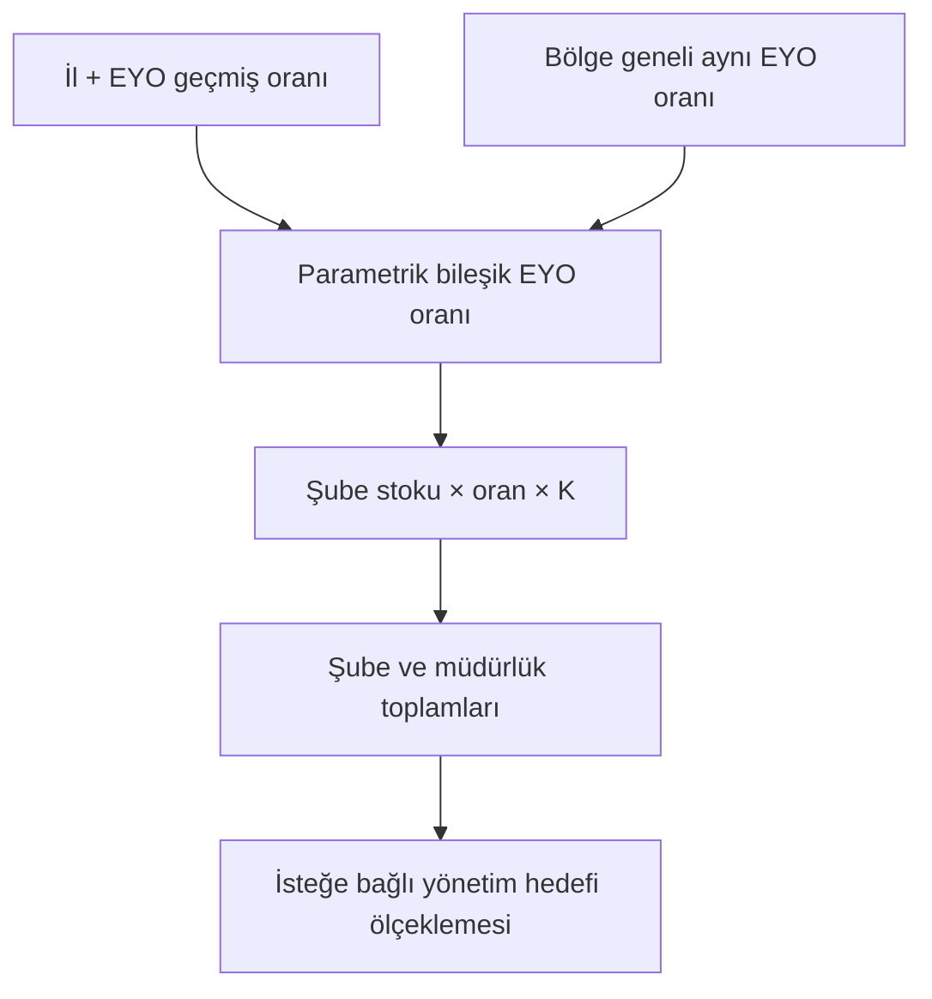

# Tahsilat Hedefleme ve Senaryo Platformu

**Açıklanabilir, parametrik ve tarayıcıda çalışan çeyreklik hedefleme demosu.** İl/EYO geçmişini Bölge ortak EYO performansıyla birleştirir; şube hedeflerinden müdürlük toplamına ulaşır. Bölge ve Merkez yönetim hedefleri birbirinden bağımsız ele alınır.

> Bu yayındaki tüm başlangıç verileri sıfırdan üretilmiştir. Gerçek müşteri, personel, kurum, hesap veya portföy kaydı içermez. Gerçek veri ve kurum içi doküman yüklemeyin. Bu çalışma onaylı bir bankacılık ürünü veya finansal tahmin garantisi değildir.

## Hızlı başlangıç

1. [Tek HTML demoyu](../../../TAHSILAT-HEDEFLEME-DEMO.html) indirin; güncel masaüstü tarayıcıda açın. Kurulum veya internet gerekmez.
2. **Genel bakış**, **Bölge hedefleri**, **Merkez hedefleri** ve **Hedef açıklamaları** ekranlarını inceleyin.
3. **Parametreler** bölümünde il/ortak EYO karışımını veya geçmiş çeyrek ağırlıklarını değiştirin.
4. **Performans** ve **Veri kalite** ekranlarından etkileri takip edin; senaryo kaydedin.
5. **Raporlar** bölümünden Excel, JSON veya hayali şema içeren SQL paketini indirin.

HTML bağlantısı GitHub kod görünümünü açar; dosyayı **Download raw file** ile indirip yerel açın. GitHub Pages yayını bu eklemenin kapsamında değildir.

## İş problemi ve yaklaşım

Tek başına yerel tahsilat oranı, portföy yaşı ve teminat dağılımından etkilenebilir. Model, farklı EYO tiplerini birbirine karıştırmadan, her **il + EYO** oranını **aynı EYO'nun Bölge havuzu oranı** ile dengeler. Ortak oran basit il ortalaması değil, toplam tahsilatın toplam açılış stokuna oranıdır. Merkez portföyleri Bölge EYO havuzuna dahil edilmez.



## Hesaplama özeti

| Bileşen | Tanım |
| --- | --- |
| Yerel oran | İl ve aynı EYO için, son üç çeyreğin tahsilat/stok oranları; eskiden yeniye örnek %20 / %30 / %50 |
| Ortak EYO oranı | Bölge havuzunda aynı EYO için toplam tahsilat / toplam stok; geçmiş ağırlıkları yerelden bağımsız |
| Bileşik oran | Örnek %50 yerel + %50 ortak; iki ağırlık parametrik |
| H | Geçmiş gerçekleşen tahsilat / verilmiş hedef endeksi |
| V endeksi | İlgili performans havuzunun tahsilat/stok oranı / referans havuz oranı |
| K | Ağırlıklı H ve V endekslerinin α ile birleşimi; örnek alt/üst sınır 0,90 / 1,10 |
| Model hedefi | Şube-EYO stoku × kullanılan oran × K; satırlar toplanır |
| Yönetim hedefi | Seçilen toplam / model toplamı ile oransal dağıtım; kuruş farkları deterministik dağıtılır |

Örnek: il oranı %4, ortak EYO oranı %8 ise 50/50 bileşik oran %6 olur. 100 milyon TL örnek stok, K=0,90 iken 5,4 milyon TL model katkısı üretir. K etkisini kaldırmak için alt ve üst sınır 1 seçilebilir. Bunlar yalnızca sentetik örneklerdir.

Eksik dönemlerde seçilen ağırlıklar geçerli dönemler arasında yeniden ağırlıklandırılır. Eksik/uygunsuz oran, negatif net oran, il havuzu ikamesi ve manuel oran politikaları açıklama ekranında görünür. Sıfır stok, sıfır tahsilatla aynı şey sayılmaz. Kısmi dönemler otomatik olarak tam çeyreğe uzatılmaz.

## Öne çıkan yetenekler

- Excel/CSV içe aktarma, sütun eşleştirme ve kaynak bazında kontroller.
- Devir ilişkileri, mükerrerlik, eksik alan, kaynak ölçüsü ve mutabakat kontrolleri.
- Ayrı Bölge/Merkez hesapları; senaryo kaydı ve geriye dönük açıklamalar.
- Yerel, ortak ve bileşik oranları; efektif ağırlıkları içeren Excel raporu.
- Şube hedeflerini değiştirmeden personel portföy atamasına aktarım için atama ekranı.
- JSON yedeği ve tek HTML dışa aktarma; ağ/veritabanı bağlantısı olmadan çalışma.

Atama ekranı personel ve şube eşleştirme girdileri ister; gerçek çalışan listesi demo içinde verilmez. İndirilebilir atama şablonunun başlangıç personel/şube dizileri boştur.

## Demo verisi ve SQL

[Sentetik JSON projesi](../../../examples/collection-targeting/README.md): 12 şube, 4 il, 4 Bölge ve 2 Merkez birimi. 2026-Q1–Q3 geçmişi ve Q4 portföyü. Yedek yalnızca örnek kayıtlar içerir.

[SQL paketi](../../../sql/collection-targeting/README.md): dört rapor sorgusu, üç hayali tablo ve küçük bir sentetik test veri kümesi. Gerçek şema ve kaynak sütun adları değiştirilmiştir. Genel HTML içe aktarma takma adları korunmuştur. Uygulama SQL çalıştırmaz.

## Veri güvenliği ve yerel kayıt

Başlangıçta veri bellektedir. İsteğe bağlı yerel kaydın anahtarları bu demoya özeldir; eski kurum uygulamasının `localStorage` kayıtları otomatik okunmaz veya silinmez. JSON ve Excel dışa aktarma sonradan yüklediğiniz verileri içerebilir. HTML dışa aktarma ana model veri dizilerini gömmez; kullanıcı verilerini repository'ye göndermeyin. Bu bir erişim kontrolü, KVKK uygunluk veya kapsamlı sızma testi taahhüdü değildir.

## Geliştirici doğrulaması

Harici paket kurulumu gerektirmez; Node.js 18+ ve Python 3 standart kütüphaneleri yeterlidir.

```bash
node tests/collection-targeting/model.cjs
node tests/collection-targeting/runtime.cjs
python tests/collection-targeting/privacy.py
python tests/collection-targeting/sql_test.py
```

23 model testi; 14 işlevsel DOM/Excel/JSON/CSV testi; içerik/SQL paketi gizlilik kontrolleri; 7 sentetik SQL testi bulunur. DOM testleri gerçek tarayıcı yerleşim testi değildir. SQL kontrolleri sınırlı SQLite uyarlamasıdır; canlı Oracle üzerinde doğrulama yapılmamıştır. Demo verisinde onay kontrolleri bilerek kapalıdır; tutarlar gerçek/nihai hedef değildir.

## Teknoloji ve lisans

HTML/CSS/JavaScript; saf hesaplama motoru; Web Worker; gömülü SheetJS ve ExcelJS. Üçüncü taraf bileşen notları için [THIRD-PARTY-NOTICES](THIRD-PARTY-NOTICES.md). Repository için yeni bir açık kaynak lisansı verilmemiştir; mevcut portföyün lisans durumu korunur.

[Ana portföy](../../../README.md) · [Proje listesi](../README.md)
